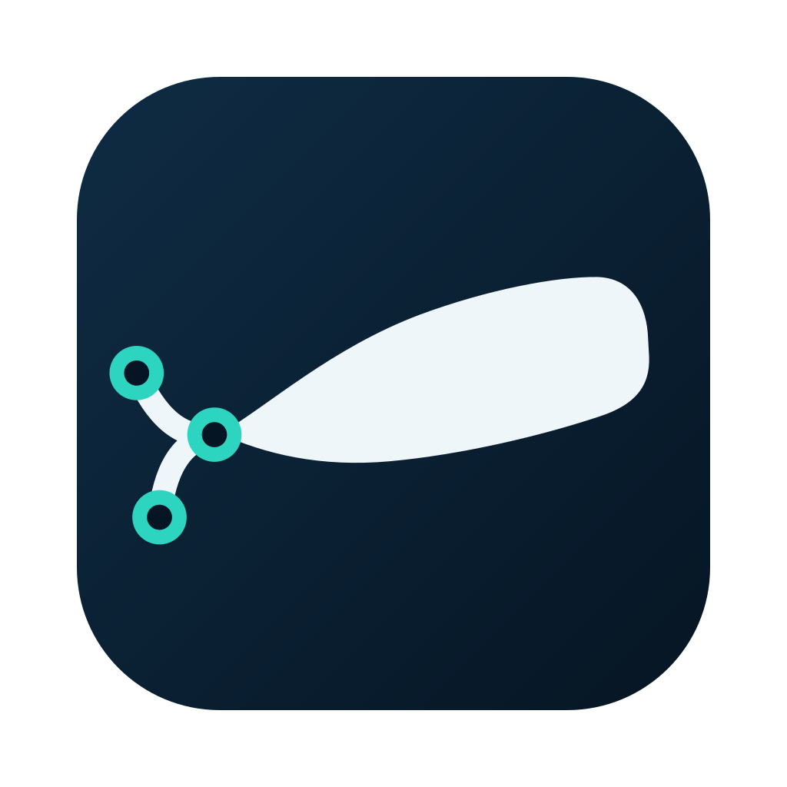
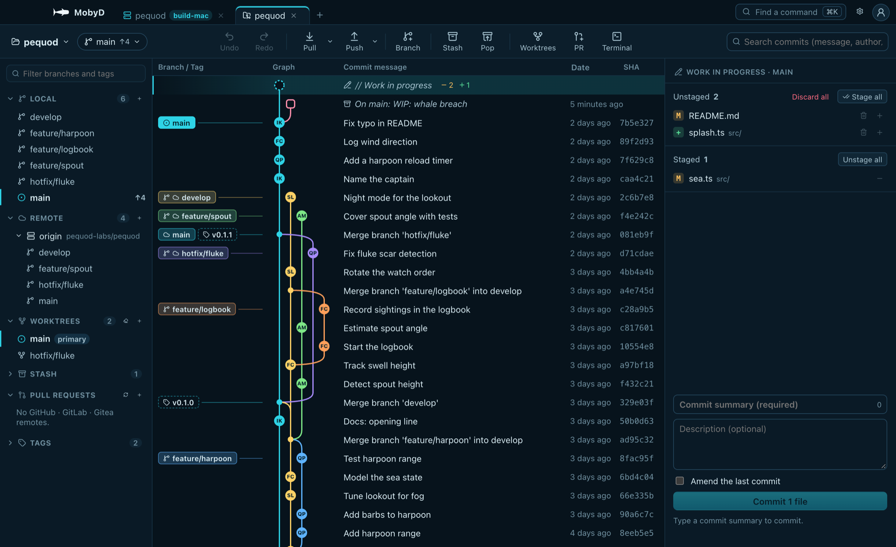
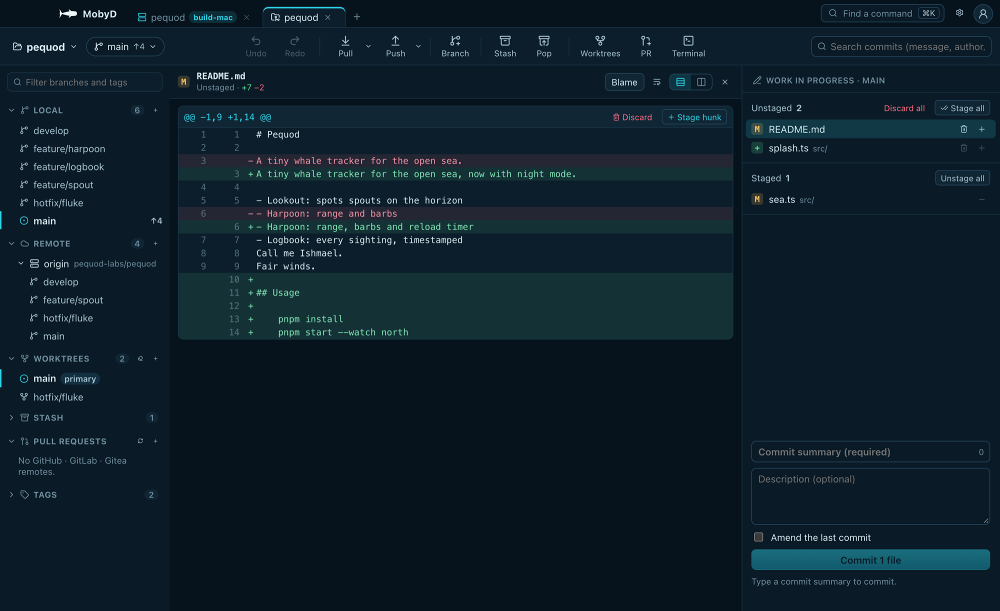
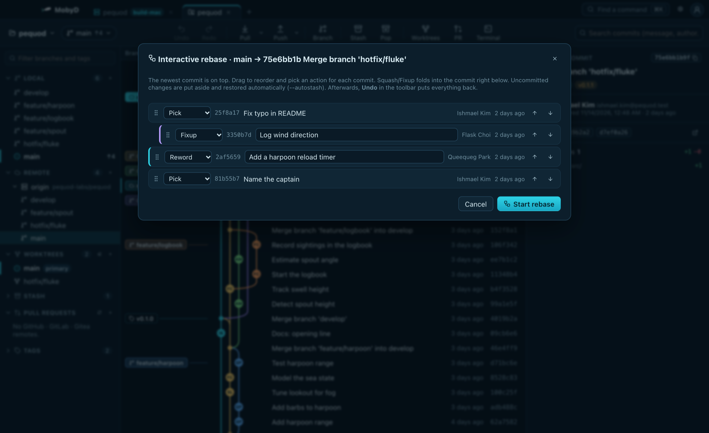
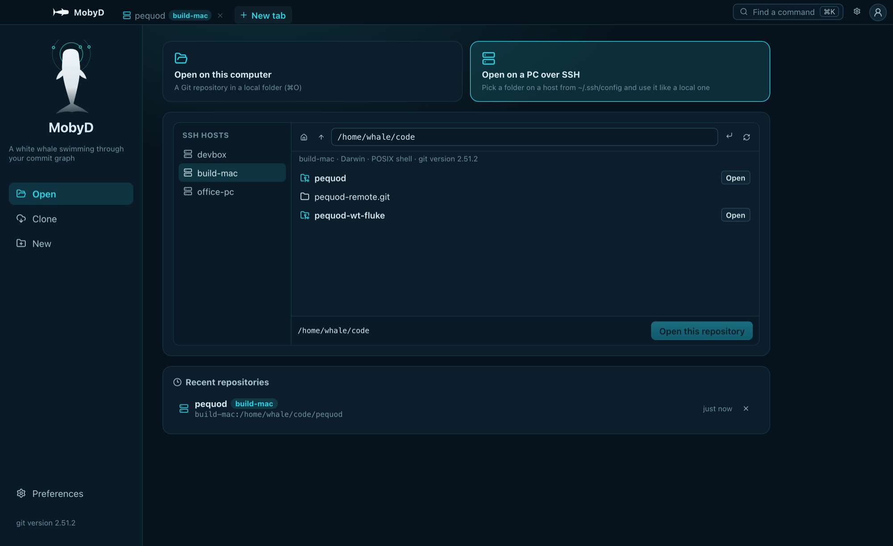
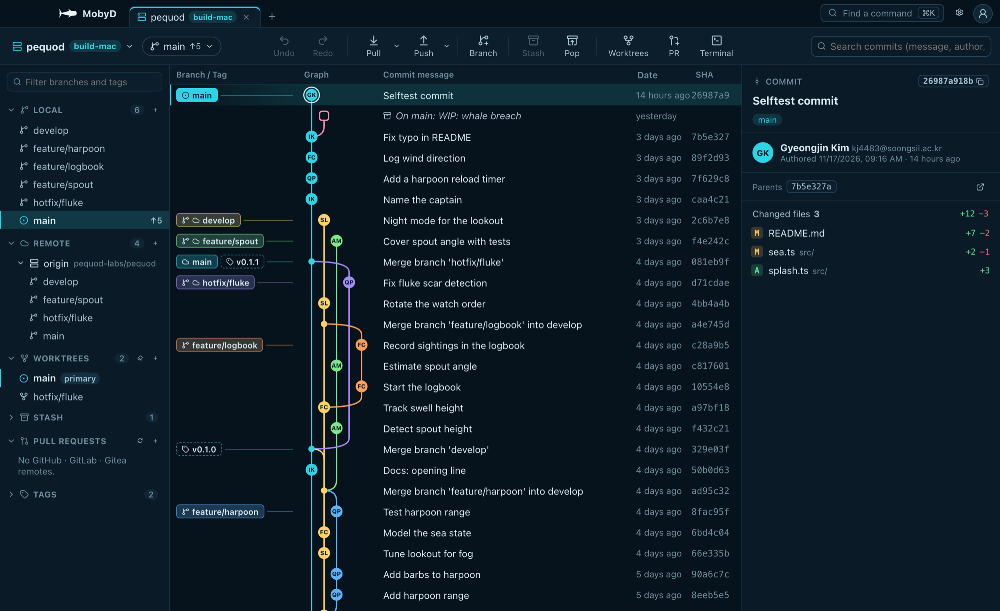
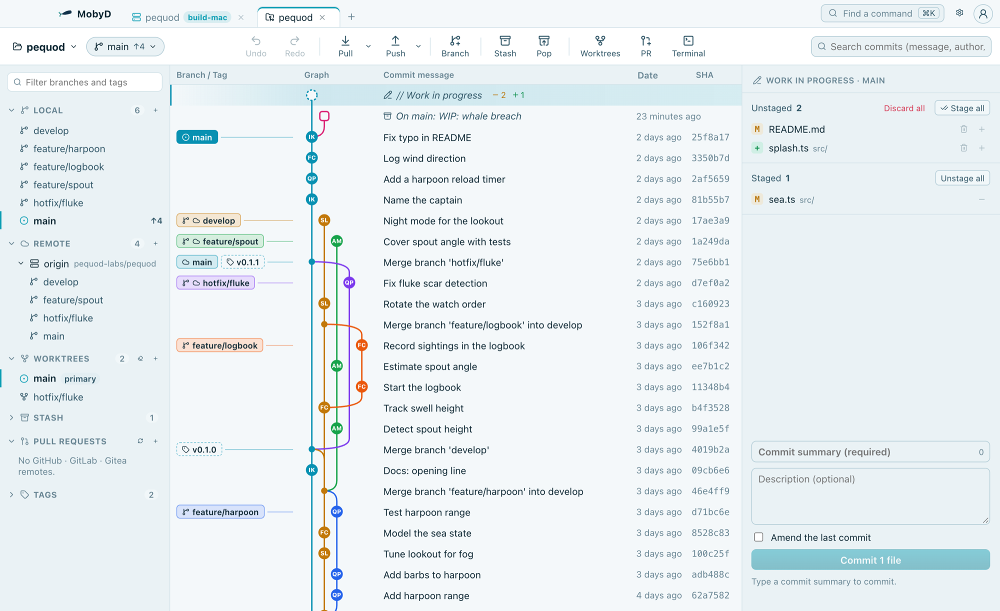

<p align="center">
  
</p>

<h1 align="center">MobyD</h1>

<p align="center">
  <a href="README.md">English</a> · <b>한국어</b>
</p>

<p align="center">
  빠르고 가벼운 macOS용 Git 클라이언트. 다른 PC에 있는 저장소도 SSH로 바로 다룹니다.
</p>

<p align="center">
  <a href="https://github.com/gyeongjin-kim/MobyD-releases/releases/latest"></a>
  <a href="https://github.com/33Lab-Soongsil-University/MobyD/actions/workflows/ci.yml"></a>
  
</p>

<p align="center">
  <a href="https://github.com/gyeongjin-kim/MobyD-releases/releases/latest/download/MobyD-macOS-arm64.dmg"><b>⬇ macOS용 MobyD 내려받기 (.dmg)</b></a>
</p>

<p align="center">
  
</p>

---

## 왜 "MobyD"인가요?

GitKraken의 이름은 바다 전설 속 거대 오징어 **크라켄**에서 왔습니다. 대왕오징어의 천적은 단 하나, **향유고래**입니다. 그중 가장 유명한 향유고래가 흰 고래 **모비 딕**이고, 그래서 **MobyD**입니다. 로고는 그 고래를 깊은 바다 아래에서 올려다본 모습입니다. 수면에서 내려오는 빛의 고리 아래 고래가 곧게 떠 있고, 고리 위에 커밋이 올라탑니다.

MobyD는 GitKraken을 쓰며 계속 부딪힌 문제에서 시작했습니다. GitKraken은 무겁고(Electron 앱 전체), *다른* 컴퓨터에 있는 저장소는 다루지 못합니다. MobyD는 작은 네이티브 앱(약 7MB)이고, SSH로 접속하는 PC의 저장소를 노트북의 저장소와 똑같이 다룹니다.

## 기능

- **커밋 그래프**: 색으로 나뉜 레인, 병합 곡선, 브랜치·태그·원격 라벨, WIP와 stash 노드. 커밋이 수천 개여도 부드럽게 스크롤됩니다.
- **일상적인 Git 작업**: 파일·헝크·한 줄 단위 스테이징, 커밋과 amend, 브랜치, 병합, 리베이스, 체리픽, revert, reset, 태그, stash, fetch·pull·push.
- **인터랙티브 리베이스**: pick, reword, edit, squash, fixup, drop, 끌어서 순서 바꾸기.
- **실행 취소·다시 실행**(⌘Z / ⇧⌘Z): 커밋, 체크아웃, 병합, 리베이스, reset, 브랜치·태그 변경.
- **Blame**과 **파일 히스토리**.
- **워크트리**: 목록 보기, 추가, 새 탭으로 열기, 잠금, 제거.
- **GitHub, GitLab, Gitea·Forgejo**: 브라우저(GitHub)나 토큰으로 로그인하면 계정이 접근할 수 있는 저장소를 모두 보고 여러 개를 한 번에 복제합니다. 풀 리퀘스트를 보고, 만들고, 리뷰하고, 병합합니다.
- **다크·라이트 테마**, 시스템 설정 따르기. 영어·한국어 UI.
- **자동 업데이트**: 클릭 한 번으로 새 버전을 설치하고 다시 시작합니다.
- **현재 위치 표시**: 이 폴더가 체크아웃한 커밋에 고리와 아이콘이 붙고(마우스를 올리면 브랜치와 폴더가 보임), 다른 워크트리가 체크아웃한 커밋에도 아이콘이 붙습니다. 스크롤해서 벗어나면 돌아가는 버튼이 나옵니다.
- **둘러보기**: 처음 실행하면 기본 사용법을 단계별로 안내합니다. 위쪽 막대의 **?** 나 ⌘K에서 다시 볼 수 있습니다.
- **명령 팔레트**(⌘K), Git 원문 대신 읽기 쉬운 오류 메시지, 웹 페이지에서 저장소를 여는 `mobyd://` 링크.

<table>
  <tr>
    <td width="50%"></td>
    <td width="50%"></td>
  </tr>
  <tr>
    <td align="center"><sub>변경을 검토하고 헝크나 한 줄만 스테이징</sub></td>
    <td align="center"><sub>인터랙티브 리베이스: 순서 바꾸기, reword, squash, fixup, drop</sub></td>
  </tr>
</table>

### SSH 저장소: GitKraken이 못 하는 부분

`~/.ssh/config`의 호스트를 고르고 폴더를 둘러본 뒤 그곳의 저장소를 엽니다. 그래프, 스테이징, 커밋, 병합, 리베이스, blame, 워크트리, 풀 리퀘스트가 모두 로컬처럼 동작합니다.

- **상대 PC에는 Git만 있으면 됩니다.** macOS, Linux, Windows(Git for Windows) 호스트를 지원합니다.
- **어떤 로그인 셸이든 됩니다.** bash, zsh, fish, cmd, PowerShell, Git Bash. MobyD가 알아서 감지하고, 셸을 바꾸라고 하지 않습니다.
- **지연이 짧습니다.** SSH 연결 하나를 다중화해 재사용하고, 전체 새로 고침도 왕복 한 번이면 끝납니다.
- **네트워크가 바뀌어도 따라갑니다.** SSH 설정의 사무실 주소가 응답하지 않으면 Tailscale로 같은 PC에 접속하고, 이미 신뢰한 호스트 키로 계속 확인합니다.
- 키, ssh-agent, 포트, ProxyJump 등 사용자의 SSH 설정을 그대로 씁니다.
- **상대 PC의 HTTPS 원격**: 그 PC가 로그인하지 못하면 클릭 한 번(*SSH 키로 연결*)으로 그 저장소 전용 키를 만들고, 연결된 계정으로 저장소의 배포 키에 등록한 뒤 원격을 SSH로 바꿉니다. 키가 그 저장소 하나만 열 수 있어 공용 서버에 알맞습니다. 혼자 쓰는 PC라면 명령마다 계정 토큰을 넘길 수도 있습니다(ssh의 stdin으로만 보내고, 명령줄이나 파일에는 남기지 않음).
- **SSH 키 보기**: 이 Mac과 각 호스트의 공개 키, GitHub·GitLab·Gitea 계정에 등록된 키, 저장소별 배포 키를 서로 맞춰 보여 주므로 어떤 키가 무엇인지 알 수 있습니다. 쓰지 않는 배포 키는 지울 수 있습니다.

<table>
  <tr>
    <td width="50%"></td>
    <td width="50%"></td>
  </tr>
  <tr>
    <td align="center"><sub><code>~/.ssh/config</code>에서 호스트를 고르고 폴더 둘러보기</sub></td>
    <td align="center"><sub>원격 저장소는 호스트 이름이 붙은 탭으로 열림</sub></td>
  </tr>
</table>

| 측정 항목 | LAN의 macOS | LAN의 Windows 11 | Tailscale 릴레이를 거친 Windows 10 |
|---|---|---|---|
| 저장소 열기 | 0.1초 | 0.6초 | 0.6초 |
| 그래프 새로 고침 | 0.2–0.3초 | 0.5초 | 0.6–0.75초 |
| 상태·diff·blame | 0.1초 | 0.2초 | 0.25초 |

### 라이트 테마

<p align="center">
  
</p>

## 설치

1. **[MobyD-macOS-arm64.dmg](https://github.com/gyeongjin-kim/MobyD-releases/releases/latest/download/MobyD-macOS-arm64.dmg)**(항상 최신 릴리스)를 내려받아 MobyD를 응용 프로그램 폴더로 끌어 넣습니다.
2. MobyD는 아직 공증(notarization)을 받지 않아 macOS가 처음 실행을 막습니다. **시스템 설정 → 개인정보 보호 및 보안**에서 아래로 내려 MobyD 옆의 **확인 없이 열기**를 누르거나, 다음을 실행하세요.

   ```bash
   xattr -dr com.apple.quarantine /Applications/MobyD.app
   ```

Apple silicon Mac과 Git 2.36 이상(Xcode Command Line Tools 또는 Homebrew)이 필요합니다. 이전 버전과 릴리스 노트는 [Releases](https://github.com/gyeongjin-kim/MobyD-releases/releases) 페이지에 있습니다.

MobyD는 스스로 업데이트합니다. 실행할 때와 한 시간마다 새 버전을 확인해 알려 주고, **지금 업데이트** 버튼(위쪽 막대에도 있음)을 누르면 내려받아 서명을 확인하고 설치한 뒤 다시 시작합니다. 환경설정 → 일반에서 직접 확인할 수도 있습니다.

## 기술 스택

| 계층 | |
|---|---|
| 앱 셸 | [Tauri 2](https://tauri.app) (시스템 WebView 사용, 브라우저를 함께 싣지 않음) |
| 백엔드 | Rust: `git` CLI 실행, SSH 전송, GitHub·GitLab·Gitea API 클라이언트, 토큰은 OS 키체인에 저장 |
| 프런트엔드 | React 19 + TypeScript, Vite, Zustand, TanStack Virtual |
| 테스트 | 실제 임시 Git 저장소와 가짜 포지 서버에 대한 `cargo test`, UI 로직은 Vitest, 앱 안의 자체 테스트 |

## 소스에서 빌드

Node 20 이상, pnpm, Rust(stable), Git이 필요합니다.

```bash
pnpm install
```

```bash
pnpm tauri dev
```

```bash
pnpm release   # → src-tauri/target/release/bundle/{macos/MobyD.app, dmg/*.dmg}
```

검사:

```bash
pnpm check                 # 타입 검사, 프런트엔드 테스트, clippy, Rust 테스트
pnpm release && pnpm selftest   # 앱을 빌드한 뒤 영어·한국어로 UI를 직접 조작해 확인
```

Rust 테스트에는 기능 테스트(`src-tauri/src/feature_tests.rs`)가 있습니다. UI가 부르는 것과 같은 명령으로 모든 Git 기능을 일회용 저장소와 로컬 서버 저장소에서 실행합니다. 스테이징, 커밋과 amend, 변경 버리기, 브랜치, 태그, 병합, 리베이스, 체리픽, revert, reset, 충돌, 인터랙티브 리베이스, stash, 워크트리, push, clone, fetch, pull, 각 변경 뒤의 실행 취소·다시 실행, git에 전달되는 계정 토큰까지 확인합니다. 자체 테스트(`src/lib/selftest.ts`)는 실제 앱 창에서 데모 저장소를 열고 그래프, 패널, 리베이스 편집기, 레이아웃, 명령 팔레트, 커밋과 실행 취소·다시 실행, 테마, 환경설정을 확인합니다. CI는 푸시할 때마다 프런트엔드 검사를 돌리고, 릴리스 워크플로(macOS)는 이 검사 전부와 빌드한 앱의 자체 테스트를 통과해야 배포합니다.

단축키, 브라우저에서 UI를 개발하는 dev bridge, 자체 테스트, 구조 같은 자세한 내용은 [docs/guide.ko.md](docs/guide.ko.md)와 [docs/architecture.md](docs/architecture.md)에 있습니다.

## 기여와 릴리스

작업은 `develop` 브랜치에서 합니다. 풀 리퀘스트는 `develop`으로 보내 주세요. `main`으로 가는 풀 리퀘스트는 메인테이너가 승인해야 병합됩니다.

`main`에 푸시할 때마다 릴리스됩니다. `develop`을 `main`에 병합해 푸시하세요.

```bash
git checkout main && git merge develop && git push origin main
```

워크플로가 최신 `v*` 태그의 patch 번호를 올려(0.1.9 → 0.1.10) `main`에 `Release X.Y.Z`를 커밋하고 태그를 단 뒤, `develop`도 그 커밋으로 옮깁니다. minor나 major 버전을 올리려면 병합 전에 `develop`에서 `scripts/set-version.sh 0.2.0`을 실행하세요. 최신 태그보다 높은 버전이 파일에 있으면 그대로 씁니다.

[릴리스 워크플로](.github/workflows/release.yml)는 macOS에서 앱을 빌드해 두 곳에 배포합니다. 하나는 이 저장소의 릴리스이고, 다른 하나는 공개 저장소 [MobyD-releases](https://github.com/gyeongjin-kim/MobyD-releases)입니다. 그 저장소가 위의 내려받기 링크와 실행 중인 앱이 읽는 업데이트 정보(`latest.json`)를 제공합니다.

업데이트 파일은 워크플로만 가진 키(`TAURI_SIGNING_PRIVATE_KEY`)로 서명되고, 앱은 설치 전에 `src-tauri/tauri.conf.json`의 공개 키로 서명을 확인합니다. 개인 키의 사본을 꼭 보관하세요. 앱은 그 키로 서명한 업데이트만 받아들입니다.

## 라이선스

MobyD는 다음 중 하나를 골라 쓸 수 있습니다.

- Apache License, Version 2.0 ([LICENSE-APACHE](LICENSE-APACHE))
- MIT 라이선스 ([LICENSE-MIT](LICENSE-MIT))

명시적으로 달리 밝히지 않는 한, Apache-2.0 라이선스에서 정의한 대로 MobyD에 포함되도록 의도적으로 제출한 기여는 추가 조건 없이 위와 같이 이중 라이선스로 제공됩니다.

"MobyD"라는 이름과 MobyD 로고는 이 라이선스에 포함되지 않습니다. 수정한 빌드를 배포한다면 다른 이름과 아이콘을 써 주세요.
