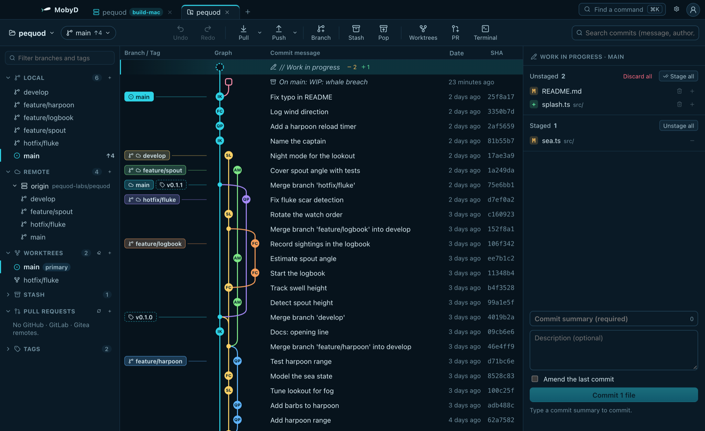
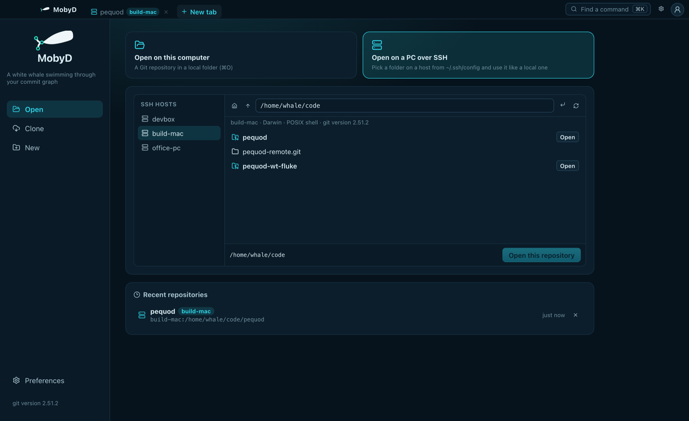
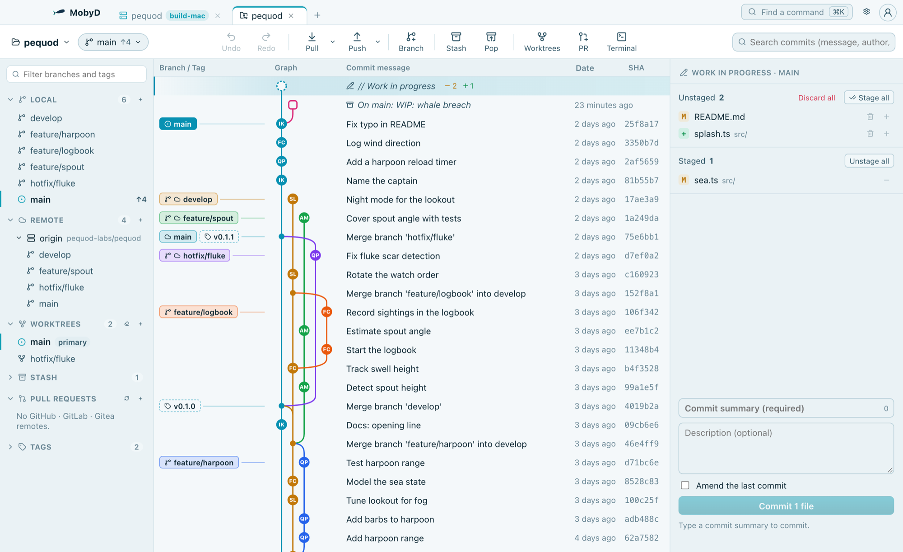

<p align="center">
  
</p>

<h1 align="center">MobyD</h1>

<p align="center">
  A fast, native Git client for macOS — with repositories on your other machines, over SSH.
</p>

<p align="center">
  <a href="https://github.com/gyeongjin-kim/MobyD/releases/latest"></a>
  <a href="https://github.com/gyeongjin-kim/MobyD/actions/workflows/ci.yml"></a>
  
</p>

<p align="center">
  <a href="https://github.com/gyeongjin-kim/MobyD/releases/latest/download/MobyD-macOS-arm64.dmg"><b>⬇ Download MobyD for macOS (.dmg)</b></a>
</p>

<p align="center">
  
</p>

---

## Why "MobyD"?

GitKraken is named after the **Kraken**, the giant squid of sea legend. The giant squid has exactly one natural enemy: the **sperm whale**. The most famous sperm whale of all is **Moby Dick**, the white whale — hence **MobyD**. The logo is that whale, with its tail drawn as a branching commit graph.

MobyD started as an answer to the things we kept running into with GitKraken: it is heavy (a full Electron app), and it cannot work on a repository that lives on *another* computer. MobyD is a small native app (~7 MB) that treats a repository on your SSH-reachable PC the same as one on your laptop.

## Features

- **Commit graph** — coloured lanes, merge curves, branch / tag / remote labels, WIP and stash nodes, smooth scrolling through thousands of commits.
- **Everyday Git** — stage files, hunks or single lines; commit and amend; branch, merge, rebase, cherry-pick, revert, reset, tags, stash, fetch / pull / push.
- **Interactive rebase** — pick, reword, edit, squash, fixup, drop, drag to reorder.
- **Undo / Redo** (⌘Z / ⇧⌘Z) for commits, checkouts, merges, rebases, resets, branch and tag changes.
- **Blame** and **file history**.
- **Worktrees** — list, add, open in a new tab, lock, remove.
- **GitHub, GitLab and Gitea / Forgejo** — sign in with the browser (GitHub) or a token, see every repository your account can reach and clone many at once; list, create, review and merge pull requests.
- **Dark and light themes**, or follow the system. English and Korean UI.
- **Command palette** (⌘K), readable error messages instead of raw Git output, `mobyd://` links to open a repository from a web page.

<table>
  <tr>
    <td width="50%"></td>
    <td width="50%"></td>
  </tr>
  <tr>
    <td align="center"><sub>Review changes and stage a hunk or a line</sub></td>
    <td align="center"><sub>Interactive rebase — reorder, reword, squash, fixup, drop</sub></td>
  </tr>
</table>

### SSH repositories — the part GitKraken doesn't do

Pick a host from your `~/.ssh/config`, browse its folders, and open a repository that lives there. Graph, staging, commit, merge, rebase, blame, worktrees and pull requests all work as if it were local.

- **Nothing to install on the other machine** except Git. macOS, Linux and Windows (Git for Windows) hosts are supported.
- **Any login shell** — bash, zsh, fish, cmd, PowerShell or Git Bash. MobyD detects it and never asks you to change it.
- **Low latency** — one multiplexed SSH connection is reused, and a full refresh runs as a single round trip.
- **Follows you between networks** — if the office address in your SSH config doesn't answer, MobyD reaches the same machine over Tailscale and still checks the host key you already trust.
- Your own SSH setup is used as-is: keys, ssh-agent, ports, ProxyJump.

<table>
  <tr>
    <td width="50%"></td>
    <td width="50%"></td>
  </tr>
  <tr>
    <td align="center"><sub>Pick a host from <code>~/.ssh/config</code> and browse its folders</sub></td>
    <td align="center"><sub>The remote repository opens in a tab marked with its host</sub></td>
  </tr>
</table>

| Measured | macOS on LAN | Windows 11 on LAN | Windows 10 via Tailscale relay |
|---|---|---|---|
| Open a repository | 0.1 s | 0.6 s | 0.6 s |
| Refresh the graph | 0.2–0.3 s | 0.5 s | 0.6–0.75 s |
| Status / diff / blame | 0.1 s | 0.2 s | 0.25 s |

### Light theme

<p align="center">
  
</p>

## Install

1. Download **[MobyD-macOS-arm64.dmg](https://github.com/gyeongjin-kim/MobyD/releases/latest/download/MobyD-macOS-arm64.dmg)** (always the latest release) and drag MobyD into Applications.
2. MobyD is not notarized yet, so the first launch is blocked by Gatekeeper. Right-click MobyD → **Open**, or run:

   ```bash
   xattr -dr com.apple.quarantine /Applications/MobyD.app
   ```

Requires macOS on Apple silicon and Git 2.36+ (Xcode Command Line Tools or Homebrew). Past versions and release notes are on the [Releases](https://github.com/gyeongjin-kim/MobyD/releases) page.

## Tech stack

| Layer | |
|---|---|
| App shell | [Tauri 2](https://tauri.app) (system WebView, no bundled browser) |
| Backend | Rust — drives the `git` CLI, SSH transport, GitHub / GitLab / Gitea API clients, OS keychain for tokens |
| Frontend | React 19 + TypeScript, Vite, Zustand, TanStack Virtual |
| Tests | `cargo test` against real temporary Git repositories and mock forge servers; Vitest for the UI logic; an in-app self-test |

## Build from source

You need Node 20+, pnpm, Rust (stable) and Git.

```bash
pnpm install
```

```bash
pnpm tauri dev
```

```bash
pnpm release   # → src-tauri/target/release/bundle/{macos/MobyD.app, dmg/*.dmg}
```

Checks:

```bash
pnpm typecheck && pnpm test && cargo test --manifest-path src-tauri/Cargo.toml
```

More detail (shortcuts, the dev bridge for working on the UI in a browser, the self-test, architecture) is in [docs/guide.ko.md](docs/guide.ko.md) and [docs/architecture.md](docs/architecture.md) (Korean).

## Releasing

Releases are built by GitHub Actions. Bump the version and push a tag:

```bash
scripts/set-version.sh 0.2.0 && git commit -am "Release 0.2.0" && git tag v0.2.0 && git push --follow-tags
```

The [release workflow](.github/workflows/release.yml) builds the app on macOS, creates the GitHub release with generated notes, and attaches `MobyD-macOS-arm64.dmg`. The download link above always points to the newest release.
